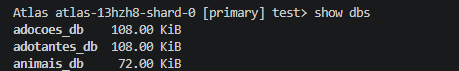
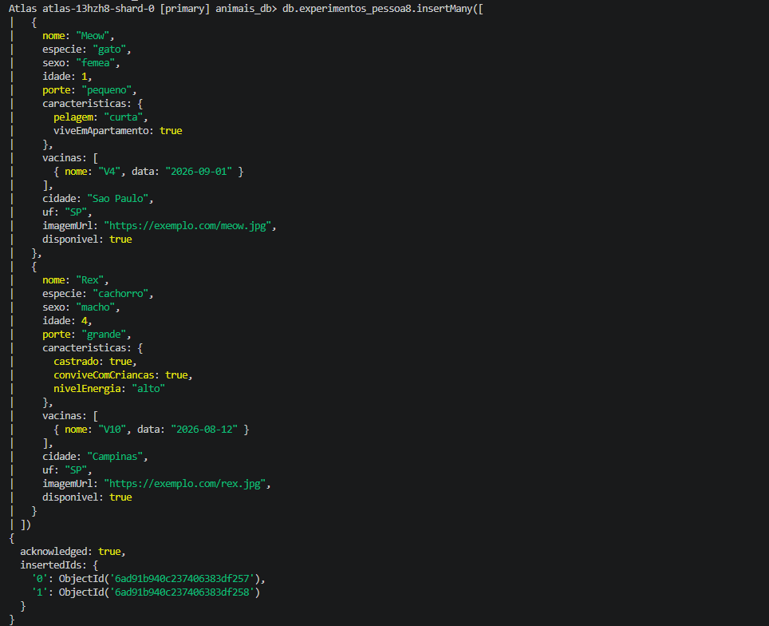
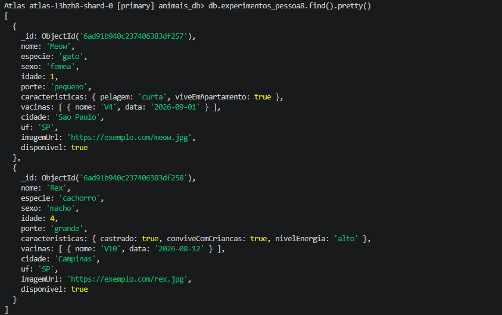
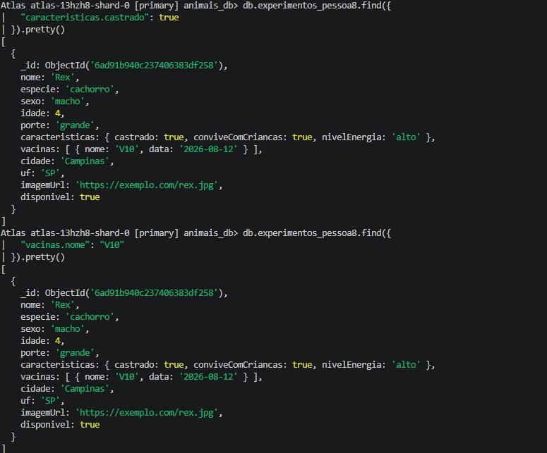
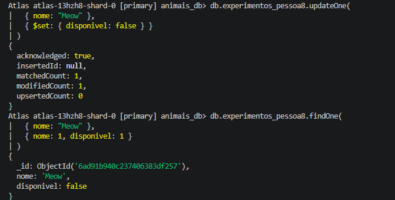

# Análise comparativa dos bancos de dados

## 1. Objetivo

Esta análise apresenta a utilização do MongoDB no projeto AdotaPet e
compara essa abordagem com uma modelagem relacional equivalente em
PostgreSQL.

O objetivo é demonstrar como cada banco representa os dados de animais,
adotantes e solicitações de adoção, considerando estrutura, flexibilidade,
consultas, relacionamentos, vantagens e limitações.

## 2. Características do MongoDB

O MongoDB é um banco de dados NoSQL orientado a documentos. Os dados são
armazenados em documentos BSON, semelhantes a objetos JSON, agrupados em
coleções.

No AdotaPet, cada microsserviço possui um banco lógico próprio:

| Microsserviço | Banco | Coleção |
|---|---|---|
| Animais | `animais_db` | `animais` |
| Adotantes | `adotantes_db` | `adotantes` |
| Adoções | `adocoes_db` | `solicitacoes` |

## 3. Modelagem no MongoDB

### 3.1 Solicitações de adoção

O microsserviço de Adoções utiliza o banco `adocoes_db` e a coleção
`solicitacoes`.

Cada documento contém os identificadores do animal e do adotante, além
de resumos históricos dos dados consultados no momento da solicitação.

```json
{
  "animalId": "6712ab34cd56ef7890123458",
  "adotanteId": "6712ab34cd56ef7890123459",
  "status": "Pendente",
  "resumoAnimal": {
    "nome": "Caramelo",
    "especie": "cachorro",
    "porte": "medio",
    "cidade": "Goiânia",
    "uf": "GO",
    "imagemUrl": "https://exemplo.com/caramelo.jpg"
  },
  "resumoAdotante": {
    "nomeCompleto": "Pessoa Fictícia",
    "idade": 31,
    "cidade": "Goiânia",
    "uf": "GO",
    "email": "pessoa.ficticia@example.com"
  },
  "criadoEm": "2026-10-19T12:00:00.000Z",
  "atualizadoEm": "2026-10-19T12:00:00.000Z"
}
```

Os resumos são cópias dos dados no momento da solicitação. Essa decisão
preserva o histórico mesmo que o animal ou o adotante seja alterado depois.
O serviço de Adoções obtém os dados dos outros microsserviços por HTTP e não
acessa diretamente os bancos `animais_db` ou `adotantes_db`.

### 3.2 Adotantes

O microsserviço de Adotantes utiliza o banco `adotantes_db` e a coleção
`adotantes`. O MongoDB gera automaticamente o campo `_id`, enquanto
`criadoEm` e `atualizadoEm` registram os timestamps do documento.

O campo `dataNascimento` é armazenado como referência para o cálculo da
idade. A idade não é gravada no documento, evitando que fique desatualizada
com o passar do tempo. Na consulta individual pela API, o serviço acrescenta
`idade` à resposta depois de calcular o valor a partir de `dataNascimento`;
esse campo calculado não é persistido no MongoDB.

```json
{
  "_id": "6712ab34cd56ef7890123456",
  "nomeCompleto": "Pessoa Fictícia",
  "dataNascimento": "1995-04-18",
  "uf": "GO",
  "telefone": "(62) 99999-1234",
  "email": "pessoa.ficticia@example.com",
  "questionario": {
    "jaTeveAnimais": true,
    "tipoMoradia": "Casa",
    "possuiQuintal": true,
    "moradiaPropria": false,
    "outrosAnimaisEmCasa": 1,
    "horasDisponiveisPorDia": 4,
    "motivoAdocao": "Quero oferecer um lar a um animal."
  },
  "criadoEm": "2026-10-19T12:00:00.000Z",
  "atualizadoEm": "2026-10-19T12:00:00.000Z"
}
```

Os campos obrigatórios são `nomeCompleto`, `dataNascimento`, `uf`,
`telefone`, `email` e `questionario`. O questionário é incorporado ao
documento como um objeto e reúne todas as respostas do adotante. Os campos
`profissao`, `endereco` e `cidade` são opcionais.

O campo `email` deve ser único. Essa restrição evita o cadastro duplicado
do mesmo adotante e é um exemplo de validação apoiada pelo banco de dados.

### 3.3 Animais

O microsserviço de Animais utiliza o banco `animais_db` e a coleção
`animais`. O modelo exige os campos `nome`, `especie`, `sexo`, `idade`,
`porte`, `cidade`, `uf` e `imagemUrl`. Os campos `caracteristicas`,
`vacinas` e `disponivel` são opcionais no cadastro.

O campo `caracteristicas` utiliza um tipo flexível e deve conter um objeto.
Isso permite representar informações específicas de cada espécie sem
alterar a estrutura principal do documento. Já `vacinas` é uma lista
incorporada, com os campos `nome` e `data`. Os itens da lista não possuem
um identificador próprio, pois representam dados pertencentes ao animal.

```json
{
  "_id": "6712ab34cd56ef7890123457",
  "nome": "Meow",
  "especie": "gato",
  "sexo": "femea",
  "idade": 0,
  "porte": "pequeno",
  "caracteristicas": {
    "fiv": false,
    "hipoalergenico": true
  },
  "vacinas": [
    {
      "nome": "V4",
      "data": "2026-09-01"
    }
  ],
  "cidade": "São Paulo",
  "uf": "SP",
  "imagemUrl": "https://exemplo.com/Meow.jpg",
  "disponivel": true,
  "criadoEm": "2026-10-19T12:00:00.000Z",
  "atualizadoEm": "2026-10-19T12:00:00.000Z"
}
```

O valor padrão de `disponivel` é `true`. A espécie aceita os valores
`cachorro`, `gato` e `outro`; o sexo aceita `macho` e `femea`; e o porte
aceita `pequeno`, `medio` e `grande`. Esses valores são normalizados para
letras minúsculas, enquanto a UF é normalizada para letras maiúsculas.
Também são validados a idade não negativa e o formato HTTP ou HTTPS da
`imagemUrl`.

## 4. Experimentos com MongoDB

Os comandos abaixo usam dados fictícios e demonstram inserção, consulta e
atualização. Para não interferir nos dados usados pela aplicação, os testes
podem ser executados em uma coleção separada, como `experimentos_pessoa8`.
Essa coleção é destinada à experimentação direta no MongoDB e não é utilizada
pelos microsserviços. Portanto, as validações do Mongoose não são aplicadas
automaticamente nela; os documentos inseridos devem respeitar manualmente o
formato apresentado no modelo.

### 4.1 Inserção de documentos com estruturas diferentes

```javascript
use animais_db

db.experimentos_pessoa8.insertMany([
  {
    nome: "Meow",
    especie: "gato",
    sexo: "femea",
    idade: 1,
    porte: "pequeno",
    caracteristicas: {
      pelagem: "curta",
      viveEmApartamento: true
    },
    vacinas: [
      { nome: "V4", data: "2026-09-01" }
    ],
    cidade: "Sao Paulo",
    uf: "SP",
    imagemUrl: "https://exemplo.com/Meow.jpg",
    disponivel: true
  },
  {
    nome: "Rex",
    especie: "cachorro",
    sexo: "macho",
    idade: 4,
    porte: "grande",
    caracteristicas: {
      castrado: true,
      conviveComCriancas: true,
      nivelEnergia: "alto"
    },
    vacinas: [
      { nome: "V10", data: "2026-08-12" }
    ],
    cidade: "Campinas",
    uf: "SP",
    imagemUrl: "https://exemplo.com/rex.jpg",
    disponivel: true
  }
])
```

Os dois documentos pertencem à mesma coleção, mas possuem propriedades
 diferentes em `caracteristicas`. Isso demonstra a flexibilidade do modelo
 orientado a documentos.

### 4.2 Consultas

Consulta por espécie e disponibilidade:

```javascript
db.experimentos_pessoa8.find({
  especie: "gato",
  disponivel: true
})
```

Consulta em campo incorporado:

```javascript
db.experimentos_pessoa8.find({
  "caracteristicas.castrado": true
})
```

Consulta em item de array:

```javascript
db.experimentos_pessoa8.find({
  "vacinas.nome": "V10"
})
```

Consulta em documento de adoção:

```javascript
use adocoes_db

db.solicitacoes.find({
  status: "Pendente",
  "resumoAnimal.especie": "cachorro"
})
```

### 4.3 Atualização

```javascript
use animais_db

db.experimentos_pessoa8.updateOne(
  { nome: "Meow" },
  { $set: { disponivel: false } }
)
```

O resultado esperado é a alteração do campo `disponivel` do documento
selecionado para `false`. No sistema, essa operação corresponde à atualização
da disponibilidade prevista no RF05.

### 4.4 Resultados observados

Os experimentos foram executados no MongoDB Atlas usando a coleção
`animais_db.experimentos_pessoa8` e dados fictícios.

- A inserção foi confirmada com `acknowledged: true` e dois documentos
  criados.
- A consulta por espécie e disponibilidade retornou somente `Meow`.
- A consulta em `caracteristicas.castrado` retornou somente `Rex`.
- A consulta em `vacinas.nome` com o valor `V10` retornou somente `Rex`.
- A atualização encontrou um documento e alterou um documento:
  `matchedCount: 1` e `modifiedCount: 1`.
- A consulta posterior confirmou `Meow` com `disponivel: false`.
- A coleção `experimentos_pessoa8` foi criada no banco `animais_db`, sem
  alterar a coleção principal `animais`.

Durante a execução, um objeto JSON de exemplo foi colado diretamente no
prompt do `mongosh`, gerando um erro de sintaxe. Esse erro não alterou o banco;
a consulta seguinte `show collections` foi executada normalmente e confirmou
as coleções `animais` e `experimentos_pessoa8`.

## 5. Modelagem equivalente no PostgreSQL

Uma modelagem relacional equivalente poderia utilizar tabelas separadas para
os documentos principais, listas e questionários:

```sql
CREATE TABLE animais (
    id UUID PRIMARY KEY,
    nome VARCHAR(100) NOT NULL,
    especie VARCHAR(30) NOT NULL,
    sexo VARCHAR(20) NOT NULL,
    idade INTEGER NOT NULL CHECK (idade >= 0),
    porte VARCHAR(20) NOT NULL,
    cidade VARCHAR(100) NOT NULL,
    uf CHAR(2) NOT NULL,
    imagem_url TEXT NOT NULL,
    disponivel BOOLEAN NOT NULL DEFAULT TRUE,
    criado_em TIMESTAMP NOT NULL,
    atualizado_em TIMESTAMP NOT NULL
);

CREATE TABLE caracteristicas_animal (
    animal_id UUID NOT NULL REFERENCES animais(id),
    chave VARCHAR(100) NOT NULL,
    valor TEXT,
    PRIMARY KEY (animal_id, chave)
);

CREATE TABLE vacinas (
    id BIGSERIAL PRIMARY KEY,
    animal_id UUID NOT NULL REFERENCES animais(id),
    nome VARCHAR(100) NOT NULL,
    data_aplicacao DATE
);

CREATE TABLE adotantes (
    id UUID PRIMARY KEY,
    nome_completo VARCHAR(150) NOT NULL,
    data_nascimento DATE NOT NULL,
    profissao VARCHAR(100),
    endereco TEXT,
    cidade VARCHAR(100),
    uf CHAR(2) NOT NULL,
    telefone VARCHAR(30) NOT NULL,
    email VARCHAR(150) UNIQUE NOT NULL,
    criado_em TIMESTAMP NOT NULL,
    atualizado_em TIMESTAMP NOT NULL
);

CREATE TABLE questionarios_adotantes (
    adotante_id UUID PRIMARY KEY REFERENCES adotantes(id),
    ja_teve_animais BOOLEAN NOT NULL,
    tipo_moradia VARCHAR(50) NOT NULL,
    possui_quintal BOOLEAN NOT NULL,
    moradia_propria BOOLEAN NOT NULL,
    outros_animais_em_casa INTEGER NOT NULL,
    horas_disponiveis_por_dia INTEGER NOT NULL,
    motivo_adocao TEXT NOT NULL
);

CREATE TABLE solicitacoes (
    id UUID PRIMARY KEY,
    animal_id UUID NOT NULL REFERENCES animais(id),
    adotante_id UUID NOT NULL REFERENCES adotantes(id),
    status VARCHAR(30) NOT NULL CHECK (status = 'Pendente'),
    resumo_animal JSONB NOT NULL,
    resumo_adotante JSONB NOT NULL,
    criado_em TIMESTAMP NOT NULL,
    atualizado_em TIMESTAMP NOT NULL
);
```

Nesta alternativa, `caracteristicas_animal` e `vacinas` substituem os dados
incorporados do documento de Animais. O tipo `JSONB` foi utilizado nos
resumos históricos apenas como uma alternativa; também seria possível
representá-los com colunas específicas. A tabela
`caracteristicas_animal` é uma simplificação relacional: para preservar
tipos, listas e estruturas arbitrárias com a mesma fidelidade do MongoDB,
seria necessário usar colunas adicionais ou `JSONB`.

## 6. Comparação entre MongoDB e PostgreSQL

| Critério | MongoDB | PostgreSQL |
|---|---|---|
| Estrutura | Documentos BSON agrupados em coleções | Tabelas relacionadas |
| Flexibilidade | Permite objetos com campos diferentes | Requer esquema definido ou `JSONB` |
| Dados aninhados | Podem ser incorporados no documento | Geralmente exigem tabelas auxiliares |
| Listas | Arrays, como `vacinas`, ficam no documento | Normalmente exigem uma tabela relacionada |
| Relacionamentos | IDs e comunicação entre APIs | Chaves estrangeiras e `JOIN` |
| Integridade referencial | Deve ser controlada pela aplicação | É reforçada pelo banco |
| Evolução do modelo | Alterações de campos tendem a ser simples | Alterações podem exigir migrações |
| Consultas relacionais | Adequado para consultas no documento | Forte para consultas complexas entre tabelas |
| Histórico | Resumos podem ser copiados para subdocumentos | Exige colunas, tabelas ou `JSONB` |
| Adequação ao projeto | Bom para dados semiestruturados e microsserviços | Bom para dados rígidos e relacionais |

## 7. Vantagens e limitações

### MongoDB

As principais vantagens observadas para o AdotaPet são:

- armazenamento natural de objetos e arrays;
- flexibilidade no campo `caracteristicas`;
- questionário incorporado ao documento do adotante;
- possibilidade de manter resumos históricos na solicitação;
- modelagem simples para bancos separados por microsserviço.

As principais limitações são:

- parte da validação depende da aplicação e do schema Mongoose;
- não há `JOIN` entre os bancos dos microsserviços;
- resumos duplicados exigem cuidado para preservar a consistência;
- consultas que atravessam serviços dependem de chamadas HTTP.

### PostgreSQL

As principais vantagens do PostgreSQL são:

- integridade referencial por chaves estrangeiras;
- transações e consistência relacional;
- consultas complexas com `JOIN`;
- restrições declarativas, como `NOT NULL`, `UNIQUE` e `CHECK`.

Neste projeto, as principais desvantagens seriam a necessidade de mais
tabelas para representar objetos e listas e a maior complexidade para alterar
campos específicos por espécie.

## 8. Conclusão

O MongoDB é adequado ao AdotaPet porque os documentos possuem estruturas
semiestruturadas. O campo `caracteristicas` pode variar conforme a espécie,
enquanto `vacinas` e `questionario` são armazenados como estruturas
incorporadas. Os resumos de uma solicitação também podem ser preservados no
próprio documento, mantendo o histórico da operação.

O PostgreSQL também atenderia aos requisitos, principalmente se o sistema
priorizasse relacionamentos rígidos, integridade referencial e consultas
complexas entre entidades. Porém, para este protótipo com três microsserviços
independentes, o MongoDB reduz a complexidade da modelagem e se adapta melhor
à flexibilidade dos dados.

Os comandos apresentados devem ser executados no MongoDB Compass ou no
`mongosh` para registrar os resultados observados e produzir as evidências
da experimentação. Nenhum dado real ou credencial deve ser incluído no
repositório.

### 4.5 Evidências da experimentação

As imagens abaixo registram a execução dos experimentos no MongoDB Atlas.
As credenciais não aparecem nas capturas.

#### Bancos disponíveis



#### Inserção dos documentos



#### Documentos armazenados



#### Consultas em campos aninhados e arrays



#### Atualização da disponibilidade

