# Relatório Técnico — Aumigo: Plataforma Comunitária de Adoção de Animais

> **Organização:** Pessoa 9. Versão consolidada em 22/10/2026 a partir do código da `main`, dos documentos em `docs/` e dos testes executados nesse dia.
> Ao final, o conteúdo será padronizado e passado para o formato de entrega (Word/PDF). Os itens marcados com **[PENDENTE]** dependem de informações que só os integrantes têm.

## Status das contribuições

| Seção | Responsável | Status |
|---|---|---|
| 1–3. Introdução, requisitos e escopo | Pessoa 1 | Completo (versão revisada dos requisitos, 21/10). Escopo atualizado com o andamento das solicitações (E23) |
| 4. Arquitetura | Pessoa 1 + Pessoa 3 | Completo, com a Figura 1 e as decisões de arquitetura |
| 5. Infraestrutura e ambiente | Pessoa 3 | Completo (base: `README.md`, `docker-compose.yml` e guia do banco) |
| 6. Design (UI/UX) | Pessoa 2 | Completo a partir do código do frontend. **[PENDENTE]** link do protótipo no Figma (EV23) |
| 7. Modelagem dos dados no MongoDB | Pessoa 8 + 5, 6, 7 | Completo, conferido com os modelos do código |
| 8. Microsserviços | Pessoas 5, 6 e 7 | Completo a partir do código e do contrato de API |
| 9. Frontend | Pessoa 4 | Completo, com prints das telas |
| 10. Experimentação MongoDB x PostgreSQL | Pessoa 8 | Completo (resumo de `docs/analise-comparativa-banco.md`) |
| 11. Testes e integração | Pessoa 9 | Completo, com os resultados de 22/10 |
| 12. Conclusão | Todos (Pessoa 1 consolida) | Conclusão geral escrita. **[PENDENTE]** um parágrafo de cada integrante (12.3) |
| 13. Referências | Todos | Referências das tecnologias usadas. Cada integrante pode acrescentar as suas |
| Apêndice A | Todos | Preenchido a partir do histórico do repositório. **[PENDENTE]** conferir nomes |

Evidências ainda não capturadas (precisam do terminal ou do Compass): EV01 (`docker compose ps`), EV03, EV19, EV20 e EV21 (Compass), EV18 (aba Network) e EV22 (persistência após `restart`). Ver o [checklist](evidencias/README.md).

## Padrões do relatório

- Idioma: português, 3ª pessoa ("o sistema permite", "foi utilizado").
- Termos padronizados: **microsserviço** (não "micro-serviço"), **interessado** (quem preenche o questionário; o serviço continua se chamando *Adotantes*), **solicitação de adoção**, **área administrativa** / **painel administrativo**, **MongoDB Atlas**, nomes dos bancos em código (`animais_db`).
- Numeração dos requisitos: usar a da **versão revisada** (RF01–RF13, RNF01–RNF11).
- Nomes de campos, rotas e comandos em `código`: `GET /animais`, `disponivel`.
- Figuras numeradas com legenda abaixo: *Figura N – Descrição. Fonte: os autores (2026).*
- Tabelas numeradas com título acima: *Tabela N – Descrição.*
- Trechos de código curtos (até ~20 linhas); o código completo fica no repositório.
- Prints sem senhas, connection strings ou dados pessoais reais (RNF09).

---

## Sumário

1. Introdução
2. Requisitos
3. Delimitação do escopo
4. Arquitetura
5. Infraestrutura e ambiente
6. Design da interface
7. Modelagem dos dados no MongoDB
8. Microsserviços
9. Frontend
10. Experimentação e análise comparativa: MongoDB x PostgreSQL
11. Testes e integração
12. Conclusão
13. Referências
- Apêndice A — Contribuições dos integrantes

---

## 1. Introdução

*Responsável: Pessoa 1 — texto da versão revisada dos requisitos (21/10/2026)*

### 1.1 Problema

Atualmente, muitos animais disponíveis para adoção são divulgados por meio de redes sociais, grupos de mensagens e publicações individuais. Como essas informações ficam espalhadas em diferentes lugares, pode ser difícil para as pessoas encontrarem animais disponíveis e obterem informações sobre eles.

Além disso, a falta de um espaço organizado pode dificultar a divulgação dos animais por parte de protetores independentes e abrigos.

### 1.2 Justificativa

O Aumigo foi pensado para facilitar a divulgação de animais disponíveis para adoção, reunindo suas informações em uma única plataforma. A ideia é permitir que um administrador autorizado cadastre e gerencie os animais divulgados, enquanto as pessoas interessadas poderão consultar as informações e fazer solicitações de adoção.

O projeto também permite aplicar na prática os conteúdos estudados na disciplina, principalmente a utilização de bancos de dados não convencionais e a arquitetura de microsserviços. Para isso, será utilizado o MongoDB para armazenar os dados e três microsserviços responsáveis por animais, adotantes e solicitações de adoção.

### 1.3 Objetivos

O objetivo do Aumigo é desenvolver uma plataforma web que facilite a divulgação de animais disponíveis para adoção e permita que pessoas interessadas encontrem informações sobre eles em um único lugar.

Para isso, o sistema permitirá cadastrar e editar animais com informações como nome, espécie, sexo, idade, porte e características, além de disponibilizar um catálogo para consulta com filtros por espécie, sexo, porte e região. Também será possível que pessoas interessadas em adotar preencham um formulário com informações pessoais e perguntas sobre suas condições para cuidar de um animal, permitindo o envio de solicitações de adoção.

O projeto também tem como objetivo aplicar os conhecimentos estudados na disciplina, utilizando o MongoDB para armazenar os dados e uma arquitetura de microsserviços para separar as funcionalidades do sistema.

### 1.4 Público-alvo

O público-alvo são protetores independentes e abrigos que precisam divulgar animais disponíveis para adoção, além de pessoas que desejam adotar um animal e procuram uma forma mais organizada de encontrar essas informações.

## 2. Requisitos

*Responsável: Pessoa 1*

Os requisitos funcionais definem as funcionalidades que o Aumigo deverá oferecer aos usuários, enquanto os requisitos não funcionais descrevem as características técnicas necessárias para o funcionamento do sistema.

### 2.1 Requisitos funcionais

*Tabela 1 – Requisitos funcionais.*

| Código | Requisito | Descrição |
|---|---|---|
| RF01 | Cadastro de animais | O sistema deverá permitir o cadastro de animais pela área administrativa, incluindo nome, espécie, sexo, idade, porte, características, histórico de vacinas, cidade, UF e URL da imagem. |
| RF02 | Listagem de animais | O sistema deverá apresentar um catálogo com os animais cadastrados disponíveis e suas principais informações. |
| RF03 | Filtro de animais | O sistema deverá permitir filtrar os animais cadastrados por espécie, sexo, porte, cidade e UF. |
| RF04 | Consulta de animais | O sistema deverá permitir consultar as informações de um animal específico. |
| RF05 | Atualização da disponibilidade | O sistema deverá permitir alterar a disponibilidade dos animais pela área administrativa, registrando a alteração no banco de dados. Animais indisponíveis não deverão aparecer na página inicial. |
| RF06 | Questionário de adoção | O sistema deverá disponibilizar um questionário para que o interessado informe nome completo, data de nascimento, profissão, endereço, cidade, UF, telefone, e-mail, tipo de moradia, animal de interesse e informações sobre sua rotina e os motivos pelos quais deseja adotar, sem necessidade de criar uma conta. |
| RF07 | Idade mínima | O sistema deverá permitir solicitações de adoção apenas de pessoas com idade igual ou superior a 21 anos, conforme regra definida para o projeto. |
| RF08 | Solicitação de adoção | O sistema deverá permitir o envio de solicitações de adoção a partir do questionário preenchido pelo interessado, associando suas informações ao animal escolhido. |
| RF09 | Registro da solicitação | O sistema deverá registrar os dados das solicitações de adoção recebidas para armazenamento e consulta pelos serviços responsáveis. |
| RF10 | Validação da solicitação | O microsserviço de Adoções deverá consultar os serviços de Animais e Adotantes via API REST para verificar os dados necessários, a idade mínima e a disponibilidade do animal. |
| RF11 | Interface de login administrativo | O sistema deverá disponibilizar uma tela de login administrativo com campos para e-mail e senha. |
| RF12 | Edição de animais | O sistema deverá permitir a edição das informações dos animais já cadastrados por meio da área administrativa. |
| RF13 | Consulta de solicitações | O sistema deverá permitir consultar, no painel administrativo, uma lista geral das solicitações de adoção registradas, contendo informações dos interessados e dos animais solicitados. |

### 2.2 Requisitos não funcionais

*Tabela 2 – Requisitos não funcionais.*

| Código | Requisito | Descrição |
|---|---|---|
| RNF01 | Aplicação web | O sistema deverá funcionar por meio de um navegador, utilizando HTML, CSS e JavaScript no frontend. |
| RNF02 | Arquitetura de microsserviços | O backend deverá ser dividido em três microsserviços independentes: Animais, Adotantes e Adoções. |
| RNF03 | Tecnologias do backend | Os microsserviços deverão ser desenvolvidos utilizando Node.js e Express. |
| RNF04 | Comunicação entre serviços | Os microsserviços deverão se comunicar por meio de APIs REST, utilizando requisições HTTP. |
| RNF05 | Banco de dados | O sistema deverá utilizar MongoDB, com um banco lógico separado para cada microsserviço. |
| RNF06 | Independência dos serviços | Cada microsserviço deverá gerenciar seus próprios dados, sem acessar diretamente o banco de dados dos outros serviços. |
| RNF07 | Interface | O site deverá apresentar uma interface simples, organizada e responsiva. |
| RNF08 | Validação e tratamento de erros | O sistema deverá validar os dados recebidos e apresentar mensagens adequadas em situações de erro. |
| RNF09 | Dados de demonstração | O sistema deverá utilizar dados fictícios durante os testes e a apresentação, sem exigir CPF ou RG. |
| RNF10 | Privacidade dos dados | Os dados pessoais fornecidos pelos interessados no questionário de adoção não deverão ser exibidos publicamente no catálogo de animais. |
| RNF11 | Área administrativa | O sistema deverá disponibilizar uma interface administrativa destinada ao cadastro, à edição e à atualização da disponibilidade dos animais. |

## 3. Delimitação do escopo

*Responsável: Pessoa 1*

O Aumigo será desenvolvido como um protótipo de plataforma web voltada à divulgação de animais disponíveis para adoção e ao envio de solicitações por pessoas interessadas em adotá-los.

O sistema permitirá listar e consultar animais, além de filtrar os resultados por espécie, sexo, porte e região, considerando a cidade e a UF. O cadastro, a edição e a atualização da disponibilidade dos animais serão realizados por meio de uma área administrativa, que contará com uma interface de login. Quando um animal for marcado como indisponível, essa informação será atualizada no banco de dados e ele deixará de aparecer na página inicial.

Os interessados em adotar poderão preencher um único questionário com informações pessoais, tipo de moradia, animal de interesse e perguntas sobre sua rotina e os motivos pelos quais desejam adotar, sem necessidade de criar uma conta ou realizar login. Para solicitar uma adoção, será necessário atender à idade mínima de 21 anos, estabelecida como regra do projeto.

O sistema permitirá o envio de solicitações de adoção a partir do questionário preenchido pelos interessados. As solicitações registradas poderão ser consultadas em uma lista geral no painel administrativo, sem a necessidade de cadastro ou login dos interessados. Nesta versão, não será implementado um acompanhamento individual das solicitações nem etapas de aprovação ou recusa.

Como apoio à organização da equipe, o painel permite marcar o andamento de cada solicitação como "Pendente", "Em contato" ou "Concluído". Essa marcação é apenas informativa: não aprova nem recusa a solicitação e não altera a disponibilidade do animal, que continua sendo controlada pelo administrador (RF05).

O desenvolvimento utilizará MongoDB e uma arquitetura composta por três microsserviços: Animais, Adotantes e Adoções. Cada serviço será responsável por seus próprios dados, e a comunicação entre eles ocorrerá por meio de APIs REST.

Nesta versão, não serão implementados recursos como pagamentos, chat entre usuários, verificação de documentos de identidade ou análise automática de candidatos por inteligência artificial. Essas funcionalidades, assim como a avaliação das solicitações de adoção, poderão ser consideradas em versões futuras.

## 4. Arquitetura

*Responsáveis: Pessoa 1 (texto) e Pessoa 3 (infraestrutura)*

O Aumigo utiliza uma arquitetura de microsserviços, dividindo as principais funcionalidades do sistema em três serviços independentes: Animais, Adotantes e Adoções. Essa divisão permite organizar melhor as responsabilidades e demonstrar a comunicação entre diferentes serviços.

Os microsserviços são desenvolvidos utilizando Node.js e Express, com MongoDB para o armazenamento das informações. Cada serviço tem seu próprio banco de dados lógico, evitando o acesso direto aos dados dos demais serviços.

- **Microsserviço de Animais** (porta 3001, `animais_db`): cadastro, edição, listagem, consulta, filtragem por espécie, sexo, porte e região e atualização da disponibilidade dos animais. Quando um animal é marcado como indisponível, ele deixa de aparecer na página inicial.
- **Microsserviço de Adotantes** (porta 3002, `adotantes_db`): recebimento e armazenamento das informações fornecidas pelos interessados por meio do questionário de adoção, incluindo dados pessoais e respostas sobre suas condições para cuidar de um animal.
- **Microsserviço de Adoções** (porta 3003, `adocoes_db`): registro e consulta das solicitações de adoção, associando o animal escolhido às informações fornecidas pelo interessado. Antes de registrar uma solicitação, consulta os microsserviços de Animais e Adotantes, por meio de APIs REST, para verificar os dados necessários, a idade mínima estabelecida e a disponibilidade do animal. As solicitações podem ser apresentadas em uma lista geral no painel administrativo.

O sistema também conta com uma **área administrativa**, composta por uma interface de login e funcionalidades de cadastro, edição e atualização da disponibilidade dos animais, além da consulta geral das solicitações de adoção registradas. Essa área faz parte do frontend e usa as APIs dos três microsserviços, sem a necessidade de criar um microsserviço adicional.

A comunicação entre os microsserviços ocorre por meio de APIs REST, utilizando requisições HTTP. Dessa forma, o microsserviço de Adoções obtém as informações necessárias dos outros serviços sem acessar diretamente seus bancos de dados. A Figura 1 resume os componentes e as chamadas entre eles.

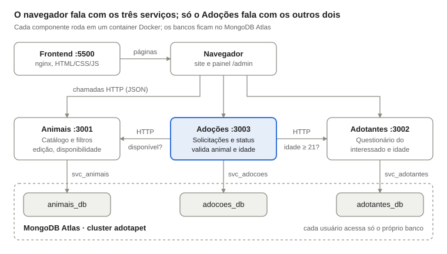

*Figura 1 – Arquitetura do Aumigo: frontend, três microsserviços e um banco lógico por serviço no MongoDB Atlas. Fonte: os autores (2026).*

O navegador recebe as páginas do container do frontend e, a partir delas, chama diretamente as APIs dos três serviços. Apenas o serviço de Adoções conversa com os outros dois, sempre por HTTP.

### 4.1 Decisões de arquitetura

*Tabela 3 – Decisões de arquitetura e justificativas.*

| Decisão | Justificativa | Requisitos |
|---|---|---|
| Um usuário do Atlas por serviço (`svc_animais`, `svc_adotantes`, `svc_adocoes`), cada um com acesso apenas ao próprio banco | Garante na prática que nenhum serviço lê o banco de outro: uma tentativa seria bloqueada pelo próprio Atlas | RNF05, RNF06 |
| Comunicação síncrona por HTTP/REST entre Adoções e os outros dois serviços, com tempo limite de 3 segundos | A validação da solicitação precisa da resposta na hora. Se um serviço não responder a tempo, Adoções devolve `503` em vez de ficar esperando | RF10, RNF04 |
| Resumo do animal e do interessado copiado na solicitação (`resumoAnimal`, `resumoAdotante`) | Preserva o histórico do pedido e permite listar as solicitações no painel sem consultar os outros serviços a cada linha, inclusive com eles fora do ar | RF09, RF13 |
| Data de nascimento armazenada em vez da idade | A idade é calculada a cada consulta e nunca fica desatualizada | RF06, RF07 |
| A solicitação não altera a disponibilidade do animal | Sem etapa de aprovação nesta versão, só o administrador decide quando o animal deixa o catálogo | RF05, RF09 |
| Área administrativa no próprio frontend, sem microsserviço extra | O painel usa as mesmas APIs do site. O login é apenas de interface (RF11), sem autenticação no backend nesta versão (ver 12.2 e E21) | RF11, RNF11 |
| Docker Compose para todo o ambiente, com fuso `America/Sao_Paulo` nos containers | Todos os integrantes sobem o mesmo ambiente com um comando. O fuso evita que a regra dos 21 anos use o dia errado entre 21h e meia-noite (E06) | RNF02, RF07 |

## 5. Infraestrutura e ambiente

*Responsável: Pessoa 3*

O código está no repositório `github.com/Athurgomes/adotapet`, organizado em uma pasta por componente: `frontend/`, `services/animais/`, `services/adotantes/`, `services/adocoes/`, `tests/` e `docs/`. O ambiente completo é descrito em um único arquivo `docker-compose.yml`, agrupado no projeto `projeto-adotapet`.

### 5.1 Containers

*Tabela 4 – Containers do Docker Compose.*

| Container | Imagem base | Porta no computador | Função |
|---|---|---|---|
| `frontend` | `nginx:1.27-alpine` | 5500 | Entrega o site público e o painel (`/admin/`) |
| `animais` | `node:24-alpine` | 3001 | Microsserviço de Animais |
| `adotantes` | `node:24-alpine` | 3002 | Microsserviço de Adotantes |
| `adocoes` | `node:24-alpine` | 3003 | Microsserviço de Adoções |
| `testes` | `node:24-alpine` | — | Testes de integração. Só roda sob demanda (perfil `testes`) |

Os três serviços usam Express 5 e Mongoose 9. Cada um tem uma verificação de saúde (`GET /health`) que o Docker consulta a cada 15 segundos, e todos reiniciam sozinhos em caso de falha (`restart: unless-stopped`). Durante o desenvolvimento, a pasta `src/` de cada serviço é montada no container e o Node reinicia ao salvar um arquivo (`node --watch`).

### 5.2 Variáveis de ambiente

*Tabela 5 – Variáveis de ambiente dos serviços.*

| Variável | Serviço | Valor |
|---|---|---|
| `PORT` | todos | 3001, 3002 ou 3003 |
| `DB_NAME` | todos | `animais_db`, `adotantes_db` ou `adocoes_db` |
| `MONGODB_URI` | todos | Connection string do usuário do serviço, lida do arquivo `.env` (fora do Git) |
| `TZ` | todos | `America/Sao_Paulo` |
| `ANIMAIS_API_URL` | adocoes | `http://animais:3001` |
| `ADOTANTES_API_URL` | adocoes | `http://adotantes:3002` |

Entre containers, cada serviço é encontrado pelo nome na rede do Docker (`http://animais:3001`). O navegador usa `localhost`, com os endereços definidos em `frontend/js/config.js`.

### 5.3 MongoDB Atlas

O banco fica em um cluster gratuito (M0) no MongoDB Atlas chamado `adotapet`, com três bancos lógicos: `animais_db` (coleção `animais`), `adotantes_db` (`adotantes`) e `adocoes_db` (`solicitacoes`).

*Tabela 6 – Usuários do MongoDB Atlas.*

| Usuário | Permissão | Uso |
|---|---|---|
| `svc_animais` | Leitura e escrita em `animais_db` | Microsserviço de Animais |
| `svc_adotantes` | Leitura e escrita em `adotantes_db` | Microsserviço de Adotantes |
| `svc_adocoes` | Leitura e escrita em `adocoes_db` | Microsserviço de Adoções |
| `exp_pessoa8` | Leitura e escrita nos 3 bancos | Experimentos da seção 10 |
| `leitura_geral` | Somente leitura nos 3 bancos | Conferência dos dados no Compass |

As senhas ficam apenas no arquivo `.env` e em um arquivo de credenciais distribuído ao grupo; os dois estão no `.gitignore`.

### 5.4 Como executar

Com o Docker Desktop aberto e o arquivo `.env` na raiz do projeto:

```bash
git clone https://github.com/Athurgomes/adotapet.git
cd adotapet
docker compose up -d --build
```

O site fica em <http://localhost:5500>, o painel em <http://localhost:5500/admin/> e a saúde dos serviços em `http://localhost:300X/health`. Os testes de integração rodam com `docker compose run --rm testes` (seção 11).

## 6. Design da interface

*Responsável: Pessoa 2*

> **[PENDENTE — Pessoa 2]** Link do protótipo no Figma e print do protótipo (EV23).

A interface adota uma identidade acolhedora, com o nome **Aumigo**, tons de roxo e lavanda sobre fundo creme e cantos bem arredondados. O site público e o painel compartilham a mesma paleta e as mesmas fontes.

*Tabela 7 – Paleta de cores (definida em `frontend/css/style.css`).*

| Uso | Cor | Código |
|---|---|---|
| Fundo das páginas | Creme | `#fffaf4` |
| Títulos e texto principal | Roxo escuro | `#40327f` / `#352a57` |
| Botões e destaques | Roxo principal | `#7663dd` |
| Faixas e áreas de destaque | Lavanda | `#8f7be8` |
| Fundos suaves | Lavanda clara | `#e9e2ff` |
| Detalhes decorativos | Laranja | `#f1a85b` |
| Selo "Vacinado" e status "Disponível" | Verde | `#dff2df` (fundo), `#438448` (texto) |
| Texto secundário | Cinza arroxeado | `#756d83` |

- **Tipografia:** *Fredoka* nos títulos, por ser arredondada e amigável, e *Nunito Sans* no texto corrido e nos formulários (Google Fonts).
- **Componentes:** cards de animais com foto, nome, sexo, idade, porte, cidade e o selo "Vacinado"; botões em formato de pílula para os filtros por espécie; formulários com campos arredondados e mensagens de erro em vermelho logo acima do botão de envio; tabelas com selos coloridos de status no painel.
- **Fluxo de navegação:** página inicial → catálogo com filtros → botão do card → formulário de interesse já com o animal escolhido → tela de confirmação. O painel tem duas abas, "Cadastro de animais" e "Adotantes", e um botão para sair.
- **Responsividade (RNF07):** o layout se reorganiza em uma coluna em telas pequenas, com pontos de quebra em 768, 820 e 1024 px. Na largura de um celular (375 px), o catálogo exibe um card por linha e não há rolagem horizontal (Figura 3).

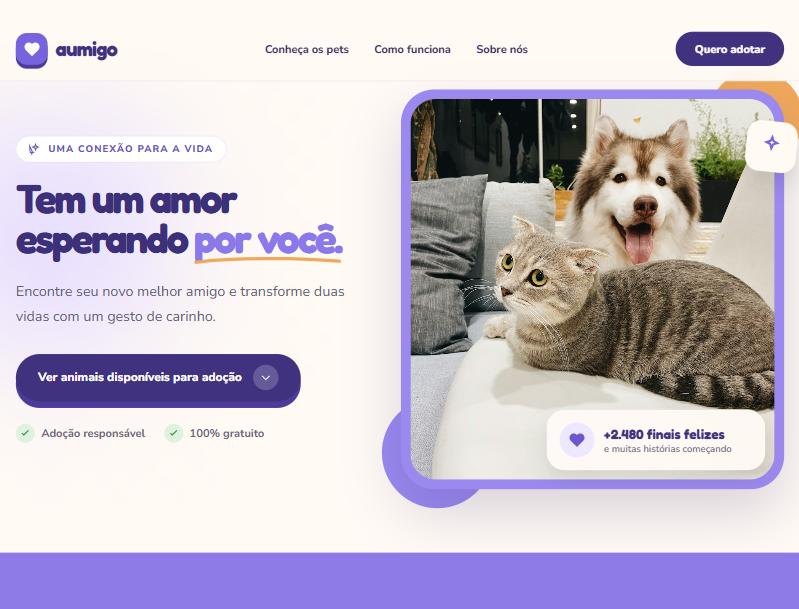

*Figura 2 – Página inicial do site. Fonte: os autores (2026).*

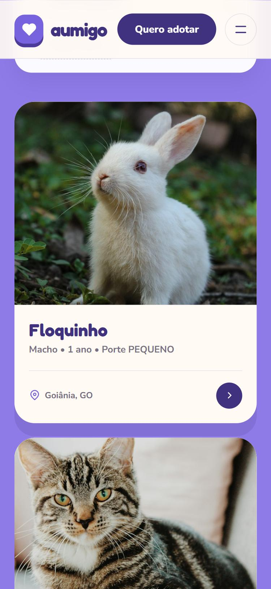

*Figura 3 – Catálogo na largura de um celular (375 px). Fonte: os autores (2026).*

## 7. Modelagem dos dados no MongoDB

*Responsáveis: Pessoa 8, com as Pessoas 5, 6 e 7*

Cada microsserviço guarda uma única coleção no próprio banco. Os documentos usam campos em português, em `camelCase` e sem acento, e todos recebem `criadoEm` e `atualizadoEm` automaticamente (opção `timestamps` do Mongoose). A modelagem aproveita duas características do modelo de documentos: campos de estrutura livre e dados incorporados (listas e subdocumentos dentro do próprio documento).

### 7.1 Animais (`animais_db.animais`)

São obrigatórios `nome`, `especie` (`cachorro`, `gato` ou `outro`), `sexo` (`macho` ou `femea`), `idade` (não negativa), `porte` (`pequeno`, `medio` ou `grande`), `cidade`, `uf` (duas letras) e `imagemUrl` (endereço `http` ou `https`). `disponivel` tem valor padrão `true`.

O campo `caracteristicas` é de estrutura livre (tipo `Mixed`), desde que seja um objeto. Assim, um gato pode ter `pelagem` e `fiv`, e um coelho `tipo` e `alimentacao`, na mesma coleção e sem alterar o modelo. `vacinas` é uma lista incorporada de `{ nome, data }`, sem identificador próprio, porque as vacinas só existem como parte do animal.

```json
{
  "nome": "Amora", "especie": "gato", "sexo": "femea", "idade": 1, "porte": "pequeno",
  "caracteristicas": { "temperamento": "Curiosa e brincalhona", "pelagem": "Rajada", "fiv": false },
  "vacinas": [{ "nome": "V4" }],
  "cidade": "Goiânia", "uf": "GO",
  "imagemUrl": "https://images.unsplash.com/photo-...", "disponivel": true
}
```

### 7.2 Adotantes (`adotantes_db.adotantes`)

São obrigatórios `nomeCompleto`, `dataNascimento` (texto `AAAA-MM-DD`, data real e não futura), `profissao`, `endereco`, `cidade`, `uf`, `telefone`, `email` e `questionario`. O e-mail é guardado em minúsculas e tem **índice único**, que impede o mesmo interessado de se cadastrar duas vezes.

O `questionario` é um subdocumento incorporado com as respostas sobre a adoção: `jaTeveAnimais`, `tipoMoradia`, `possuiQuintal`, `moradiaPropria`, `outrosAnimaisEmCasa` (inteiro ≥ 0), `horasDisponiveisPorDia` (0 a 24) e `motivoAdocao`. A idade não é armazenada: o serviço a calcula a partir de `dataNascimento` sempre que o cadastro é consultado. Não há CPF nem RG (RNF09).

### 7.3 Solicitações (`adocoes_db.solicitacoes`)

Cada solicitação guarda `animalId`, `adotanteId`, `status` (`Pendente`, `Em contato` ou `Concluído`) e dois resumos copiados no momento do pedido.

```json
{
  "animalId": "6ad994c668b5ceb2ebe62bc6", "adotanteId": "6ad3d8dcd179ffe689bf7e2c",
  "status": "Pendente",
  "resumoAnimal": { "nome": "Thor", "especie": "cachorro", "porte": "medio", "cidade": "Goiânia", "uf": "GO", "imagemUrl": "https://..." },
  "resumoAdotante": { "nomeCompleto": "Ana Teste Goiás", "idade": 31, "cidade": "Goiânia", "uf": "GO", "email": "ana@exemplo.com" }
}
```

Os ids são apenas referências: como cada serviço tem o próprio banco, não há `JOIN` nem chave estrangeira entre coleções, e a existência do animal e do interessado é conferida pela API no momento do pedido. Um **índice único parcial** em `{ animalId, adotanteId }`, aplicado só às solicitações com status `Pendente`, impede pedidos pendentes duplicados mesmo quando duas requisições chegam ao mesmo tempo.

## 8. Microsserviços

Os três serviços seguem o mesmo padrão: JSON em todas as respostas, erros no formato `{ "erro": "...", "detalhes": [...] }`, `400` para JSON malformado e uma rota `GET /health`. O contrato completo, com exemplos de requisição e resposta, está em `docs/contrato-api.md`.

### 8.1 Microsserviço de Animais

*Responsável: Pessoa 5*

*Tabela 8 – Rotas do microsserviço de Animais.*

| Método | Rota | Descrição | Sucesso | Erros |
|---|---|---|---|---|
| `POST` | `/animais` | Cadastrar animal (RF01) | 201 | 400 |
| `GET` | `/animais` | Listar com filtros opcionais (RF02, RF03) | 200 | 400 |
| `GET` | `/animais/:id` | Consultar um animal (RF04) | 200 | 400, 404 |
| `PUT` | `/animais/:id` | Editar animal (RF12) | 200 | 400, 404 |
| `PATCH` | `/animais/:id/disponibilidade` | Alterar a disponibilidade (RF05) | 200 | 400, 404 |

- **Filtros:** `especie`, `sexo`, `porte`, `cidade`, `uf` e `disponivel`, combináveis na query string (ex.: `GET /animais?especie=gato&uf=GO&disponivel=true`). Valores fora da lista geram `400`; parâmetros vazios são ignorados. A cidade é comparada pelo nome completo, sem diferenciar maiúsculas. A lista vem do mais recente para o mais antigo.
- **Validações:** o cadastro aceita só os campos do modelo (`_id` e datas enviadas pelo cliente são ignorados), normaliza espécie, sexo e porte para minúsculas e a UF para maiúsculas. A edição altera apenas os campos enviados e valida o documento inteiro de novo. A disponibilidade exige um booleano de verdade: `"false"` ou `0` são recusados.
- **Robustez:** ids fora do formato do MongoDB geram `400` antes de consultar o banco. Sem conexão com o banco, todas as rotas respondem `503` na hora, em vez de deixar a requisição esperando.

### 8.2 Microsserviço de Adotantes

*Responsável: Pessoa 6*

*Tabela 9 – Rotas do microsserviço de Adotantes.*

| Método | Rota | Descrição | Sucesso | Erros |
|---|---|---|---|---|
| `POST` | `/adotantes` | Registrar o interessado e o questionário (RF06) | 201 | 400, 409 |
| `GET` | `/adotantes` | Listar interessados (painel, RF13). Com `?email=`, devolve só aquele cadastro | 200 | 400 |
| `GET` | `/adotantes/:id` | Consultar um interessado, com a idade calculada (RF07, RF10) | 200 | 400, 404 |

- **Validações:** campos obrigatórios de texto, data de nascimento real e não futura, UF com duas letras, formato de e-mail e todas as respostas do questionário com o tipo certo. Os erros voltam juntos em `detalhes`, para o site mostrar tudo de uma vez.
- **E-mail único:** o índice único do banco recusa o segundo cadastro com o mesmo e-mail, e o serviço responde `409`. O site então busca o cadastro existente por `?email=` e o reaproveita, sem baixar a lista de todos os interessados (RNF10, E22).
- **Cálculo da idade:** feito na consulta por id, considerando se o aniversário do ano já passou, no fuso de Brasília. É esse campo `idade` que o serviço de Adoções usa para aplicar a regra dos 21 anos.

### 8.3 Microsserviço de Adoções

*Responsável: Pessoa 7*

*Tabela 10 – Rotas do microsserviço de Adoções.*

| Método | Rota | Descrição | Sucesso | Erros |
|---|---|---|---|---|
| `POST` | `/adocoes` | Registrar solicitação (RF08, RF09, RF10) | 201 | 400, 404, 409, 422, 503 |
| `GET` | `/adocoes` | Listar solicitações, com filtros `animalId`, `adotanteId` e `status` (RF13) | 200 | 400 |
| `GET` | `/adocoes/:id` | Consultar uma solicitação | 200 | 400, 404 |
| `PATCH` | `/adocoes/:id/status` | Alterar o andamento no painel | 200 | 400, 404 |

O `POST /adocoes` recebe apenas `animalId` e `adotanteId` e segue as etapas da Tabela 11. Cada consulta aos outros serviços tem tempo limite de 3 segundos.

*Tabela 11 – Validação de uma solicitação de adoção.*

| Etapa | Verificação | Resposta se falhar |
|---|---|---|
| 1 | Os dois ids estão no formato do MongoDB (24 caracteres hexadecimais) | `400` |
| 2 | `GET /animais/:id` no serviço de Animais: o animal existe | `404` (ou `503` se o serviço não responder) |
| 3 | O animal está disponível | `409` "Animal indisponível para adoção." |
| 4 | `GET /adotantes/:id` no serviço de Adotantes: o interessado existe | `404` (ou `503`) |
| 5 | O interessado tem 21 anos ou mais | `422` "Idade mínima para adoção é 21 anos." |
| 6 | Não há outra solicitação pendente do mesmo interessado para o mesmo animal | `409` |
| 7 | Grava a solicitação com status `Pendente` e os resumos | `201` |

Respostas inesperadas dos outros serviços (por exemplo, `503` porque o banco deles caiu, ou um corpo sem os campos esperados) também resultam em `503`. Assim, o site consegue distinguir "dados inválidos" de "serviço indisponível". A rota `/health` de Adoções informa, além do próprio banco, se Animais e Adotantes estão no ar.

## 9. Frontend

*Responsável: Pessoa 4*

O frontend é feito em HTML, CSS e JavaScript puros (RNF01), servido pelo nginx. Ele nunca acessa o banco: todas as informações vêm das APIs, cujos endereços estão em `frontend/js/config.js`. Os textos vindos das APIs são escapados antes de entrar na página, para que um nome com HTML não execute código (E15).

### 9.1 Site público

- **Catálogo (RF02, RF05):** carrega `GET /animais?disponivel=true`, então animais indisponíveis não aparecem. Mostra quatro cards por vez, com o botão "Ver mais" (Figura 4).
- **Filtros (RF03):** espécie (Todos, Cachorros, Gatos), sexo, porte e um campo de texto que busca por cidade, UF ou nome. Os filtros são aplicados no navegador sobre a lista já carregada, o que deixa a resposta instantânea; a API também aceita os mesmos filtros na query string (Figura 5). Sem resultados, aparece uma mensagem pedindo para mudar as opções.
- **Consulta do animal (RF04):** o card mostra foto, nome, sexo, idade, porte, cidade/UF e o selo "Vacinado" quando há vacinas. Nesta versão não há uma página de detalhes com as características completas, que podem ser consultadas pela API (`GET /animais/:id`) e no painel.
- **Questionário e solicitação (RF06, RF08):** o botão do card abre o formulário com o animal já selecionado (Figura 6). Ao enviar, o site registra o interessado em `POST /adotantes` e depois a solicitação em `POST /adocoes`. A tela de confirmação só aparece quando o serviço de Adoções responde `201` (Figura 7).
- **Mensagens de erro (RNF08):** o site mostra a mensagem enviada pela API, como "Idade mínima para adoção é 21 anos." (Figura 18). Se algum serviço estiver indisponível, mostra que não foi possível registrar a solicitação naquele momento (Figura 20).

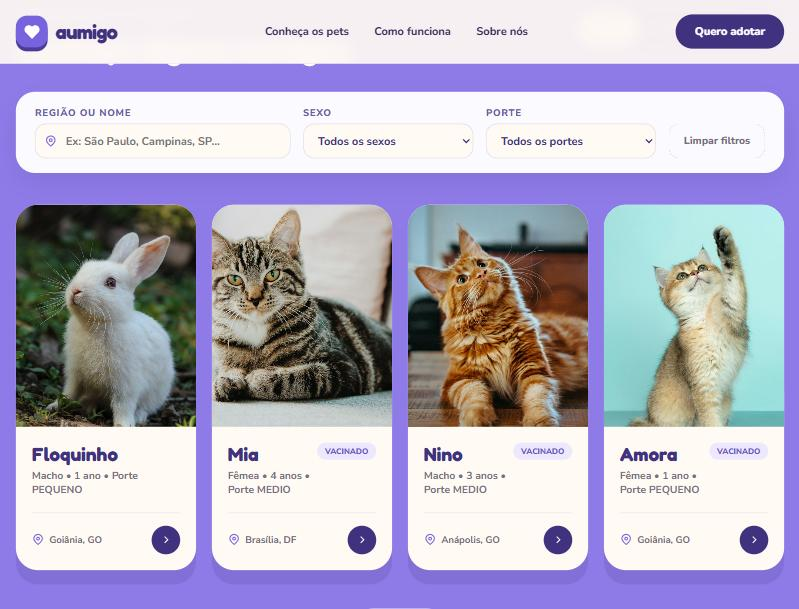

*Figura 4 – Catálogo de animais disponíveis. Fonte: os autores (2026).*

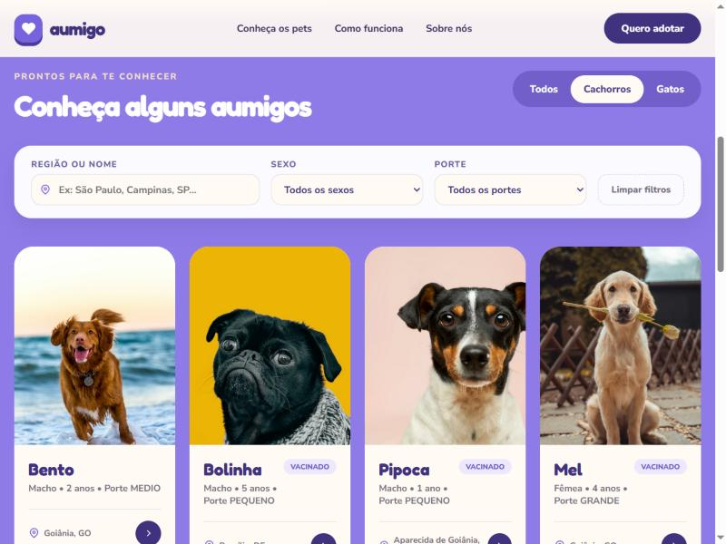

*Figura 5 – Catálogo filtrado por espécie (Cachorros). Fonte: os autores (2026).*

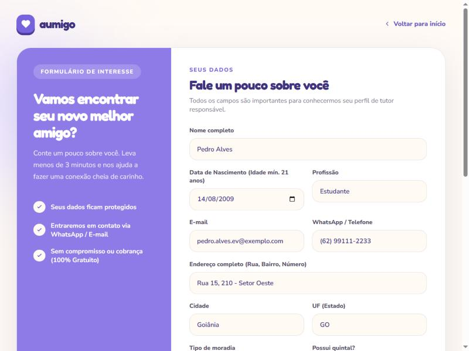

*Figura 6 – Formulário de interesse preenchido com dados fictícios. Fonte: os autores (2026).*

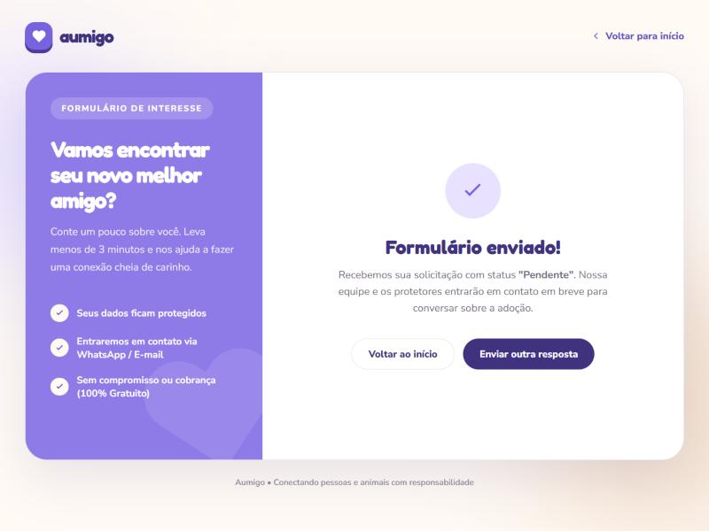

*Figura 7 – Confirmação da solicitação, registrada com status "Pendente". Fonte: os autores (2026).*

### 9.2 Painel administrativo

- **Login (RF11):** tela com e-mail e senha. Com dados incorretos, mostra uma mensagem de erro (Figura 8). A sessão fica guardada apenas na aba do navegador (`sessionStorage`), e o botão "Sair" volta para o login.
- **Cadastro de animais (RF01, RNF11):** formulário com todos os campos do modelo. Características e vacinas podem ser digitadas como texto; sem URL de imagem, o painel usa uma foto padrão por espécie. O animal cadastrado aparece no topo da tabela (Figura 9). Se a API recusar os dados, a mensagem dela aparece em vermelho e o animal não entra na lista.
- **Edição e disponibilidade (RF05, RF12):** o ícone de lápis abre um modal com os dados atuais (Figura 10), que são salvos por `PUT /animais/:id`. Características e vacinas não alteradas são reenviadas como vieram da API, para não perder campos nem datas (E19). Marcar como indisponível tira o animal do catálogo (Figura 11).
- **Solicitações (RF13):** a aba "Adotantes" lista as solicitações de `GET /adocoes`, com filtros por status e busca. Clicar no nome do interessado abre a ficha com o questionário completo, vinda de `GET /adotantes` (Figura 12). O botão de status avança o andamento por `PATCH /adocoes/:id/status`, e a mudança é desfeita na tela se a API recusar.

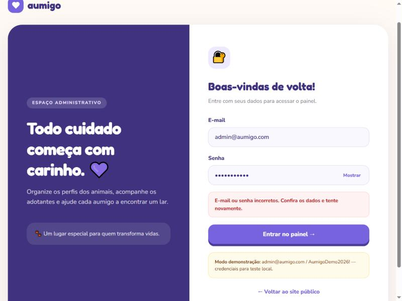

*Figura 8 – Tela de login do painel com mensagem de erro. Fonte: os autores (2026).*

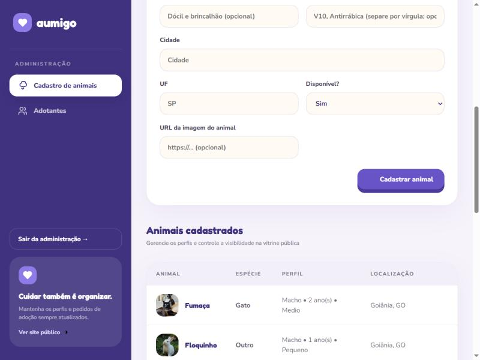

*Figura 9 – Animal recém-cadastrado no topo da tabela do painel. Fonte: os autores (2026).*

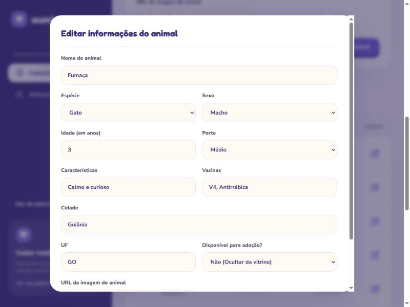

*Figura 10 – Modal de edição de animal. Fonte: os autores (2026).*

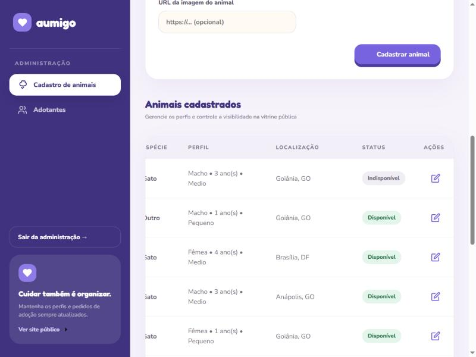

*Figura 11 – Animal marcado como indisponível na tabela do painel, após recarregar a página. Fonte: os autores (2026).*

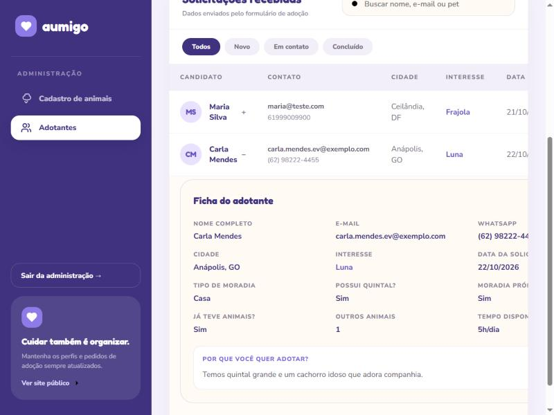

*Figura 12 – Lista de solicitações com a ficha do interessado aberta. Fonte: os autores (2026).*

## 10. Experimentação e análise comparativa: MongoDB x PostgreSQL

*Responsável: Pessoa 8*

O MongoDB é um banco NoSQL orientado a documentos: os dados ficam em documentos BSON, semelhantes a objetos JSON, agrupados em coleções. Para conhecer na prática as operações usadas pelo sistema, foram feitos experimentos no MongoDB Atlas com o usuário `exp_pessoa8`, em uma coleção separada (`animais_db.experimentos_pessoa8`), para não interferir nos dados da aplicação. O texto completo, com todos os comandos, está em `docs/analise-comparativa-banco.md`.

### 10.1 Experimentos

1. **Inserção de documentos com estruturas diferentes:** dois animais na mesma coleção, um gato com `caracteristicas: { pelagem, viveEmApartamento }` e um cachorro com `caracteristicas: { castrado, conviveComCriancas, nivelEnergia }`. A inserção retornou `acknowledged: true` com dois documentos criados (Figuras 13 e 14).
2. **Consultas:** por espécie e disponibilidade (`{ especie: "gato", disponivel: true }`), em campo incorporado (`{ "caracteristicas.castrado": true }`) e em item de lista (`{ "vacinas.nome": "V10" }`). Cada uma retornou apenas o animal esperado (Figura 15).
3. **Atualização:** `updateOne` alterando `disponivel` para `false`, operação equivalente ao RF05. O resultado foi `matchedCount: 1` e `modifiedCount: 1`, confirmado por uma consulta posterior (Figura 16).


*Figura 13 – Bancos acessíveis no MongoDB Atlas. Fonte: os autores (2026).*


*Figura 14 – Inserção de documentos com estruturas diferentes. Fonte: os autores (2026).*


*Figura 15 – Consultas em campo incorporado e em item de lista. Fonte: os autores (2026).*


*Figura 16 – Atualização da disponibilidade de um documento. Fonte: os autores (2026).*

A Figura 17 mostra os documentos armazenados na coleção de experimentos.


*Figura 17 – Documentos armazenados na coleção de experimentos. Fonte: os autores (2026).*

### 10.2 Modelagem equivalente no PostgreSQL

Uma versão relacional dos mesmos dados precisaria de seis tabelas: `animais`, `caracteristicas_animal` (pares chave–valor), `vacinas`, `adotantes`, `questionarios_adotantes` e `solicitacoes`, ligadas por chaves estrangeiras. Os resumos históricos da solicitação poderiam usar colunas próprias ou o tipo `JSONB`. A tabela de características em pares chave–valor é uma simplificação: para preservar tipos, listas e estruturas arbitrárias com a mesma fidelidade do MongoDB, seria preciso usar `JSONB`. O script completo está na seção 5 de `docs/analise-comparativa-banco.md`.

*Tabela 12 – Comparação entre MongoDB e PostgreSQL no contexto do projeto.*

| Critério | MongoDB | PostgreSQL |
|---|---|---|
| Estrutura | Documentos agrupados em coleções | Tabelas relacionadas |
| Campos variáveis por espécie | Objeto livre em `caracteristicas` | Tabela chave–valor ou `JSONB` |
| Listas e subdocumentos | `vacinas` e `questionario` ficam no próprio documento | Tabelas auxiliares e `JOIN` |
| Relacionamentos | Ids e consultas entre APIs | Chaves estrangeiras e `JOIN` |
| Integridade referencial | Controlada pela aplicação | Garantida pelo banco |
| Evolução do modelo | Novos campos sem migração | Alterações exigem migração |
| Consultas entre entidades | Limitadas ao documento | Fortes, com `JOIN` e agregações |
| Histórico da solicitação | Resumos copiados como subdocumentos | Colunas extras ou `JSONB` |

### 10.3 Conclusão da análise

O MongoDB se mostrou adequado ao Aumigo porque os dados são semiestruturados: as características mudam conforme a espécie, e vacinas, questionário e resumos ficam naturalmente dentro dos documentos. A principal limitação é que parte da integridade passa a depender da aplicação: não há `JOIN` entre os bancos dos serviços, e a existência de animais e interessados é conferida por HTTP. O PostgreSQL também atenderia aos requisitos, com mais tabelas e mais rigidez, e seria preferível se o sistema dependesse de relacionamentos fortes e consultas complexas entre entidades.

## 11. Testes e integração

*Responsável: Pessoa 9*

### 11.1 Estratégia

Os testes foram organizados em quatro frentes: testes automatizados de integração das APIs, cenários de serviço fora do ar, roteiro manual do frontend e verificações de infraestrutura e banco de dados. O plano completo, com a matriz de rastreabilidade entre requisitos e casos de teste, está em `docs/testes/plano-de-testes.md`.

O script `tests/integracao.js` executa o fluxo completo (cadastro de animal → cadastro de interessado → solicitação de adoção → consulta da solicitação) e os cenários de erro previstos no contrato de API, chamando as rotas reais dos três microsserviços. Ele é executado com `docker compose run --rm testes` e gera um relatório com todas as requisições e respostas, usado como evidência.

*Tabela 13 – Resumo dos casos de teste.*

| Frente | Casos | Quantidade | O que verifica |
|---|---|---|---|
| Ambiente (automatizado) | CT01–CT05 | 5 | Serviços no ar e conectados, comunicação entre eles, CORS, rota inexistente e JSON malformado |
| Animais (automatizado) | CT10–CT23 | 14 | Cadastro com estruturas diferentes, consulta, filtros, disponibilidade, edição e validações |
| Adotantes (automatizado) | CT30–CT38 | 9 | Questionário, idade calculada, e-mail repetido, busca por e-mail e validações |
| Adoções (automatizado) | CT40–CT53 | 14 | Solicitação válida, resumos, duplicidade, idade mínima, animal indisponível, registros inexistentes, alteração de status e privacidade do catálogo |
| Serviço fora do ar | CQ01–CQ04 | 4 | Adoções detecta a queda, responde `503` e os demais serviços seguem respondendo |
| Site público (manual) | CF01–CF13 | 11 | Catálogo, filtros, questionário, mensagens de erro, responsividade e privacidade |
| Painel (manual) | CF03, CF07, CF14–CF18 | 7 | Login, cadastro, edição, disponibilidade e lista de solicitações |
| Infraestrutura e banco (manual) | CM01–CM07 | 7 | Containers, `/health`, bancos e usuários do Atlas, persistência e tecnologias |

### 11.2 Resultados

Na execução de 22/10/2026, com a `main` após as correções, **os 42 casos automatizados passaram**. Nos cenários de serviço fora do ar, cada rodada derruba um serviço: com Animais parado passaram CQ01, CQ02 e CQ04, e com Adotantes parado passaram CQ01, CQ03 e CQ04. O caso restante de cada rodada fica "bloqueado" por exigir o outro serviço parado, o que é o comportamento esperado.

*Tabela 14 – Resultado dos testes automatizados (22/10/2026).*

| Execução | Passou | Falhou | Bloqueado | Evidência |
|---|---|---|---|---|
| Fluxo completo | 42 | 0 | 0 | `evidencias/testes/integracao-20261022-042316.md` |
| Animais fora do ar | 3 | 0 | 1 (esperado) | `evidencias/testes/queda-animais-20261022-042329.md` |
| Adotantes fora do ar | 3 | 0 | 1 (esperado) | `evidencias/testes/queda-adotantes-20261022-042338.md` |

No navegador, foram reexecutados em 22/10 os casos CF01, CF02, CF05, CF06, CF09 (idade mínima), CF10, CF11, CF12, CF13, CF14, CF03, CF16, CF07, CF17 e CF18, todos com o resultado esperado. A recusa de animal indisponível (`409`) foi verificada pela API (CT47): no site, animais indisponíveis nem aparecem para seleção.

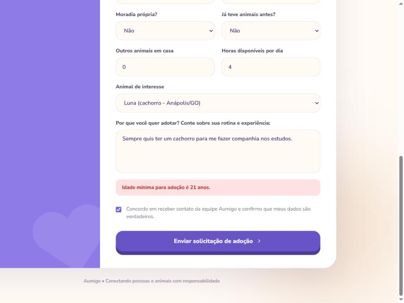

*Figura 18 – Solicitação recusada pelo serviço de Adoções porque o interessado tem menos de 21 anos (`422`). Fonte: os autores (2026).*

A primeira execução, em 21/10/2026, teve 37 de 40 casos automatizados aprovados. Os testes no navegador mostraram, além disso, falhas que os testes das APIs não pegavam, como a tela de sucesso aparecendo com o serviço de Adoções fora do ar. Esses casos reforçam a importância de testar o fluxo completo pela interface, e não só as APIs isoladamente.

### 11.3 Erros encontrados e correções

Os testes de 21/10/2026 revelaram 23 problemas, registrados em `docs/testes/registro-de-erros.md`. As correções foram aplicadas em 22/10/2026 e validadas pelos mesmos testes. A Tabela 15 resume as mais importantes; a lista completa, com causa e arquivo alterado, está em `docs/testes/correcoes-integracao.md`.

*Tabela 15 – Principais erros encontrados e correções.*

| ID | Problema | Correção | Responsável |
|---|---|---|---|
| E09 | O site mostrava "Formulário enviado!" com o serviço de Adoções respondendo `503` | A confirmação só aparece com `201`; nos demais casos, mensagem de serviço indisponível | Pessoa 4 |
| E17 | Não existia rota de edição de animal, e o painel dizia "atualizado com sucesso" sem salvar | Nova rota `PUT /animais/:id`; o painel só confirma com `200` | Pessoas 5 e 4 |
| E19 | A edição no painel apagava as características e as datas das vacinas | O painel reenvia os campos não alterados como vieram da API | Pessoa 4 |
| E18 | O painel mostrava dados de demonstração falsos quando a API falhava | Dados falsos removidos; o painel mostra o erro | Pessoa 4 |
| E06 | Containers em UTC deslocavam a regra dos 21 anos em um dia entre 21h e meia-noite | `TZ: America/Sao_Paulo` nos serviços | Pessoa 3 |
| E11 | Interessado sem cidade era aceito, mas a solicitação dele falhava com `503` | Profissão, endereço e cidade voltaram a ser obrigatórios | Pessoa 6 |
| E22 | O site baixava a lista de todos os interessados para tratar e-mail repetido | Nova busca `GET /adotantes?email=` | Pessoas 6 e 4 |
| E01 | JSON malformado respondia `500` | Resposta `400` nos três serviços | Pessoas 6 e 7 |
| E20 | O compose exigia a porta 80 livre para o `/admin` funcionar | Redirecionamento relativo no nginx; só a porta 5500 é usada | Pessoa 3 |
| E15 | Dados da API entravam no HTML sem escapar | Textos escapados antes de entrar na página | Pessoa 4 |

Em 22/10 também foi encontrado e corrigido um deslocamento horizontal da tela de confirmação do formulário, que aparecia cortada à esquerda (E24). Ficou em aberto só o login de interface (E21), tratado como limitação do protótipo em 12.2.

### 11.4 Demonstração da independência dos serviços

Com o serviço de Animais parado (`docker compose stop animais`), a rota `/health` do serviço de Adoções passou a informar `"animais": "fora do ar"` e `"adotantes": "no ar"` (Figura 19). Ao enviar um formulário pelo site, o questionário foi gravado normalmente pelo serviço de Adotantes, mas o serviço de Adoções respondeu `503` depois do tempo limite de 3 segundos, e o site mostrou a mensagem de serviço indisponível, sem a tela de sucesso (Figura 20). O painel continuou listando as solicitações, porque elas guardam o resumo do animal. Com `docker compose start animais`, o catálogo voltou em cerca de 10 segundos, tempo da reconexão com o Atlas.

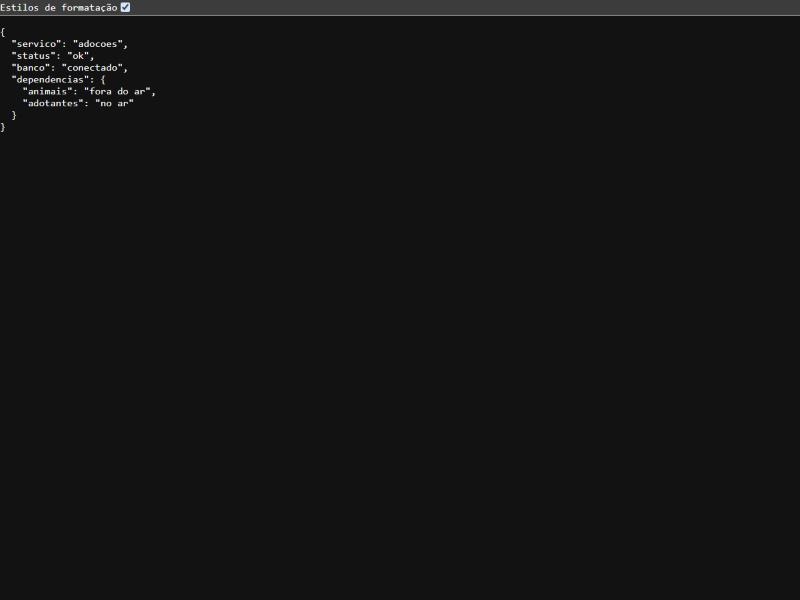

*Figura 19 – Rota `/health` do serviço de Adoções com o serviço de Animais parado. Fonte: os autores (2026).*


*Figura 20 – Mensagem exibida no site quando o serviço de Adoções responde `503`. Fonte: os autores (2026).*

## 12. Conclusão

*Todos — consolidação: Pessoa 1*

### 12.1 Resultados

O Aumigo atingiu o objetivo de reunir, em uma única plataforma, a divulgação de animais para adoção e o envio de solicitações por pessoas interessadas. Os requisitos RF01 a RF13 foram implementados e testados, com a ressalva da consulta de animal (RF04), que no site se limita às informações do card. A arquitetura com três microsserviços independentes, cada um com o próprio banco no MongoDB Atlas, funcionou como planejado: os serviços se comunicam apenas por HTTP, e a queda de um deles não derruba os outros.

O MongoDB se mostrou adequado aos dados do projeto, em especial às características que variam por espécie e aos questionários e resumos incorporados aos documentos. Os testes de integração tiveram papel central: encontraram 23 problemas antes da entrega, vários deles visíveis apenas ao testar o fluxo completo pela interface.

### 12.2 Limitações e trabalhos futuros

- **Autenticação:** o login do painel é apenas de interface; a senha de demonstração fica no código do frontend e as APIs não exigem login (E21). Uma versão real precisaria de autenticação no backend, por exemplo com tokens.
- **Página de detalhes do animal:** o site não mostra as características completas e o histórico de vacinas.
- **Aprovação e recusa de solicitações:** o andamento no painel é apenas informativo; um fluxo de aprovação poderia, ao concluir uma adoção, tornar o animal indisponível automaticamente.
- **Upload de imagens:** hoje a foto é informada por URL.
- **Isolamento físico dos bancos:** os três bancos estão no mesmo cluster gratuito do Atlas; em produção, cada serviço poderia ter um cluster próprio, eliminando esse ponto único de falha.
- **Banco separado para testes:** os testes automatizados gravam dados no mesmo banco usado pelo site, o que exige limpeza antes de demonstrações.

### 12.3 Contribuições individuais

> **[PENDENTE — todos]** Cada integrante envia um parágrafo: o que fez, a principal dificuldade e o que aprendeu.

## 13. Referências

DOCKER INC. **Docker Compose documentation**. Disponível em: <https://docs.docker.com/compose/>. Acesso em: 22 out. 2026.

FOWLER, M.; LEWIS, J. **Microservices**: a definition of this new architectural term. 2014. Disponível em: <https://martinfowler.com/articles/microservices.html>. Acesso em: 22 out. 2026.

MONGODB INC. **MongoDB Manual**. Disponível em: <https://www.mongodb.com/docs/manual/>. Acesso em: 22 out. 2026.

MONGOOSE. **Mongoose documentation**. Disponível em: <https://mongoosejs.com/docs/>. Acesso em: 22 out. 2026.

NEWMAN, S. **Building Microservices**: designing fine-grained systems. 2. ed. Sebastopol: O'Reilly Media, 2021.

OPENJS FOUNDATION. **Express**: fast, unopinionated, minimalist web framework for Node.js. Disponível em: <https://expressjs.com/>. Acesso em: 22 out. 2026.

OPENJS FOUNDATION. **Node.js documentation**. Disponível em: <https://nodejs.org/docs/latest/api/>. Acesso em: 22 out. 2026.

THE POSTGRESQL GLOBAL DEVELOPMENT GROUP. **PostgreSQL documentation**. Disponível em: <https://www.postgresql.org/docs/>. Acesso em: 22 out. 2026.

> Cada integrante pode acrescentar aqui outras referências que tenha usado.

---

## Apêndice A — Contribuições dos integrantes

*Tabela 16 – Contribuições de cada integrante.*

> **[PENDENTE]** Os nomes abaixo vieram do histórico de commits do repositório. Conferir a correspondência e preencher as Pessoas 1 e 2.

| Integrante | Nome | Responsabilidade | Principais entregas |
|---|---|---|---|
| Pessoa 1 | | Pesquisa, requisitos e organização | Documento de requisitos, escopo, texto da arquitetura |
| Pessoa 2 | | Design (UI/UX) | Identidade visual Aumigo, protótipo no Figma |
| Pessoa 3 | @Athurgomes (GitHub) | Infraestrutura e configuração | Repositório, estrutura inicial dos 3 serviços e do frontend, Docker Compose, MongoDB Atlas e usuários, guias, contrato de API inicial |
| Pessoa 4 | Marielly Moreira da Silva Oliveira | Frontend | Site público (catálogo, filtros, formulário) e painel administrativo (PRs #3 e #6) |
| Pessoa 5 | Caio Varandas | Microsserviço de Animais | Rotas de cadastro, listagem com filtros, consulta e disponibilidade (PR #4) |
| Pessoa 6 | Lucas Moura | Microsserviço de Adotantes | Rotas do questionário, validações, e-mail único e cálculo da idade (PR #2) |
| Pessoa 7 | Eric Filipe | Microsserviço de Adoções | Fluxo de validação entre serviços, resumos e regra de duplicidade (PR #1) |
| Pessoa 8 | Samuel Pinho | Experimentação e análise comparativa | Experimentos no MongoDB, modelagem relacional e comparação (PR #5) |
| Pessoa 9 | Rodrigo Barros Parreira | Integração, testes e documentação | Plano de testes, testes automatizados, registro de erros, correções de integração (PR #7) e organização do relatório |
